

# 🛡️ SafeLine WAF + DVWA Security Lab

### Web Application Firewall Deployment · HTTPS Reverse Proxy · Detection & Response Validation

**Sushil Tamang** · Aspiring SOC Analyst (Level 1) · Perth, Western Australia

**[Architecture](#-network-architecture) · [Implementation](#-step-by-step-implementation) · [Results](#-observed-results) · [Evidence Index](docs/EVIDENCE.md)**

---

## 📌 Project overview

I deployed **SafeLine WAF** in an isolated VMware-based cybersecurity lab to protect **Damn Vulnerable Web Application (DVWA)**, hosted on an Ubuntu/Apache web server. I configured SafeLine as an **HTTPS reverse proxy**, reviewed access-control and rate-limiting policies, and used an authorized Kali Linux test machine to assess how the WAF inspected and handled suspicious web requests.

The original screenshots document Apache configuration, SafeLine application settings, authentication records, traffic statistics, XSS blocking, command-injection auditing, and event monitoring. This write-up separates the **larger enterprise network design** from the **specific 192.168.177.0/24 VMware subnet visible in the deployed lab**.

> **Evidence note:** The screenshot files have been supplied for this project and are indexed by exact filenames below. GitHub image links will render after those original files are uploaded into \`assets/evidence/\`. No synthetic screenshots or fabricated attack outcomes are used as deployment evidence.

## 🎯 Objectives

- Deploy a self-hosted WAF between a security-testing client and a deliberately vulnerable web application.
- Configure Apache/DVWA on a backend service and route requests through SafeLine using HTTPS on the WAF-facing side.
- Monitor **XSS and command-injection detections**, distinguishing **Blocked** and **Audited** outcomes.
- Examine custom deny rules, semantic analysis modes, HTTP rate limiting, and authentication activity.
- Interpret attack telemetry and communicate evidence clearly from a **SOC Level 1 analyst** perspective.

## 🧰 Tools and environment

| Technology | Role in the lab |
|:--|:--|
| VMware | Isolated virtualized lab environment |
| Ubuntu | Host for the Apache/DVWA backend and SafeLine environment shown |
| Kali Linux | Authorized test client and source of web-security validation traffic |
| **SafeLine WAF v9.3.10** | Reverse proxy, filtering, access controls, and attack monitoring |
| Apache2 | DVWA backend listening on TCP **8080** |
| DVWA | Deliberately vulnerable application for controlled web-security testing |
| HTTPS / TLS | SafeLine-facing HTTPS on **443**; Apache TLS configuration is also documented separately |
| Browser and terminal | Configuration verification and event review |

## 🗺️ Network architecture

**Enterprise security architecture design — Frictional Financial Advisory**

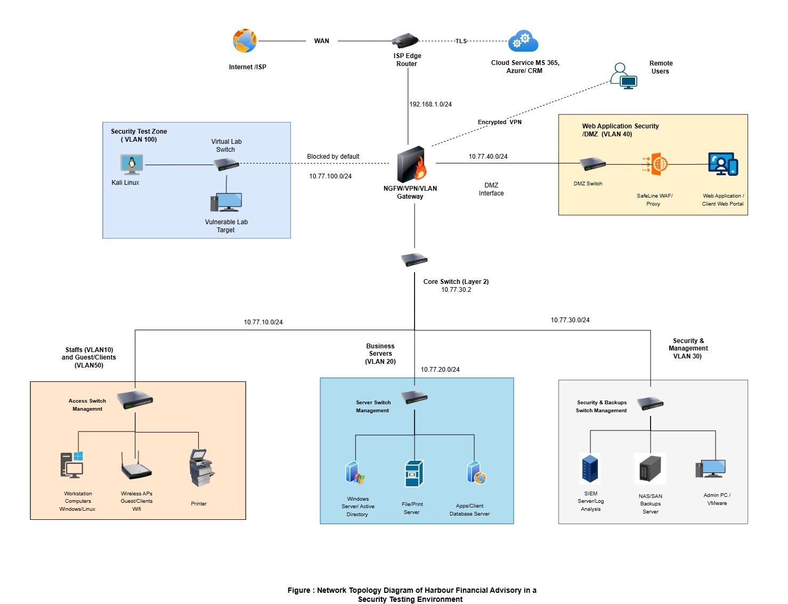

*Figure 1. Original simulated financial-enterprise topology: test zone, VLAN-based internal segments, NGFW/VPN gateway, and a proposed DMZ (VLAN 40) hosting a WAF in front of a web application. This is the user's network design artifact, not independent proof that every illustrated segment was deployed.*

The screenshot of SafeLine's protected application identifies **HTTPS/443**, **Reverse Proxy**, and upstream **http://192.168.177.138:8080**. The observed Kali source address is **192.168.177.129**. Both the proxy and backend use the same lab IP in the captured configuration; this must not be confused with the separately designed VLAN/DMZ topology.

**How SafeLine handles requests — supplied protection workflow**

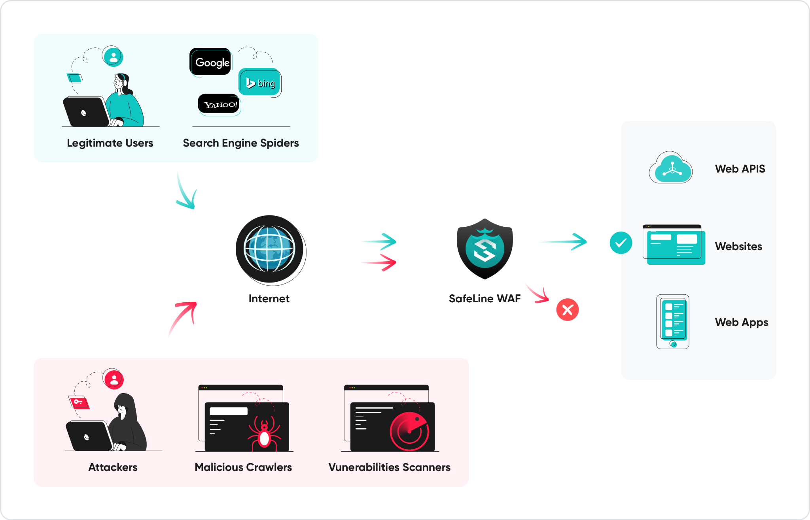

*Figure 2. Security-control workflow explaining permitted traffic and blocked suspicious requests. This is a product/concept workflow image, not an attack-log screenshot.*

## 🧱 Step-by-step implementation

### 01 · Establish the virtualized lab and security architecture

I used a virtualized Ubuntu web-server environment and Kali Linux test client to investigate web application firewall protection. The Harbour Financial Advisory diagram places a security test zone behind a gateway and a web application/WAF in a DMZ. The implementation screenshots show the test client and web server communicating within the VMware **192.168.177.0/24** segment.

### 02 · Deploy and manage SafeLine WAF

I followed the SafeLine deployment documentation and used its management script on the Ubuntu VM. The supplied terminal screenshot shows the SafeLine management interface and container-management operations; it does **not** independently establish a fresh install or an uninterrupted service startup.

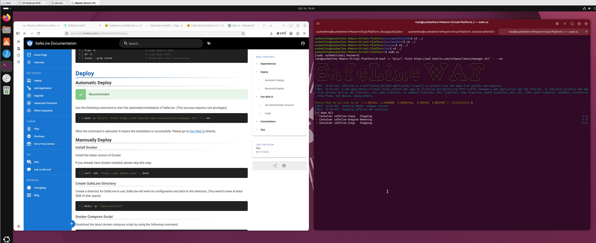

*Figure 3. SafeLine documentation alongside original terminal output from the management script.*

### 03 · Configure Apache to host the backend on port 8080

I inspected \`/etc/apache2/ports.conf\`, where the active listener is **Listen 8080**, then inspected the Apache virtual-host configuration in \`/etc/apache2/sites-available/000-default.conf\`. The captured virtual host uses **\`<VirtualHost *:8080>\`**, \`DocumentRoot /var/www/html\`, and \`ServerName webserver.tmzsusheel\`.

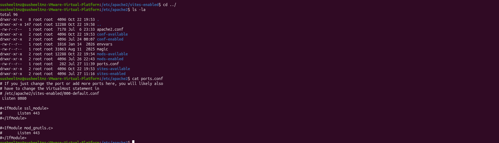

*Figure 4. Original terminal evidence showing the Apache port setting.*

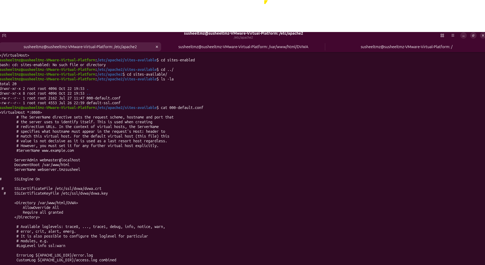

*Figure 5. Backend virtual-host configuration used for the DVWA web service.*

I also inspected Apache's enabled configuration directory and related site files.

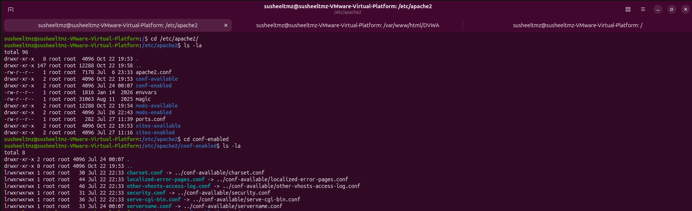

*Figure 6. Apache configuration directory and enabled configuration links.*

### 04 · Configure TLS certificate paths

The Apache \`default-ssl.conf\` screenshot identifies \`SSLEngine on\` with certificate and key paths **\`/etc/ssl/dvwa/dvwa.crt\`** and **\`/etc/ssl/dvwa/dvwa.key\`**. SafeLine's separate application settings show it receiving client connections on **443/HTTPS** and forwarding to an **HTTP/8080** upstream. Therefore, this screenshot documents Apache SSL configuration but does **not** establish end-to-end TLS between SafeLine and Apache.

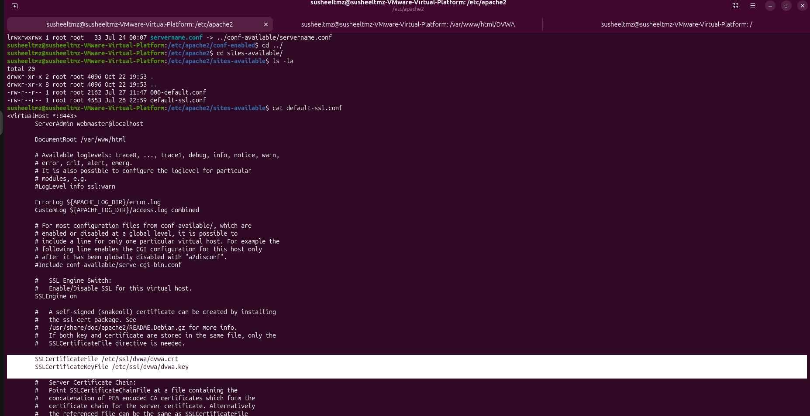

*Figure 7. Original Apache TLS configuration evidence.*

### 05 · Configure local hostname resolution

I inspected \`/etc/hosts\` on both Ubuntu and Kali. In both screenshots, **\`webserver.tmzsusheel\`** resolves to **\`192.168.177.138\`**, enabling the test client to reach the local web service by hostname.

| Ubuntu server | Kali test client |
|:--:|:--:|
| 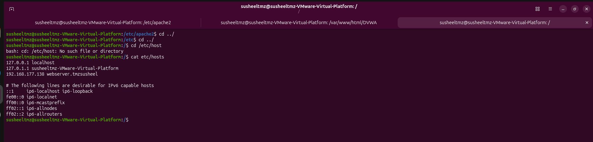 | 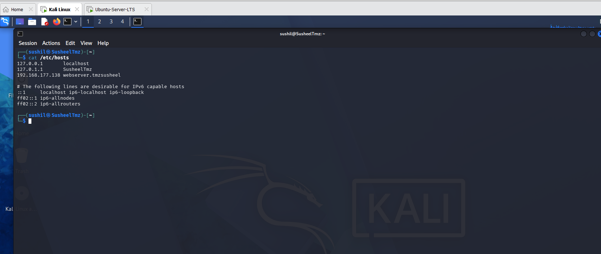 |

*Figures 8–9. Matching local hostname resolution on the backend and test machine.*

### 06 · Access the DVWA target application

From Kali Linux, I opened **\`webserver.tmzsusheel/DVWA/\`** and confirmed that the DVWA home page and its testing modules were accessible within the authorized environment.

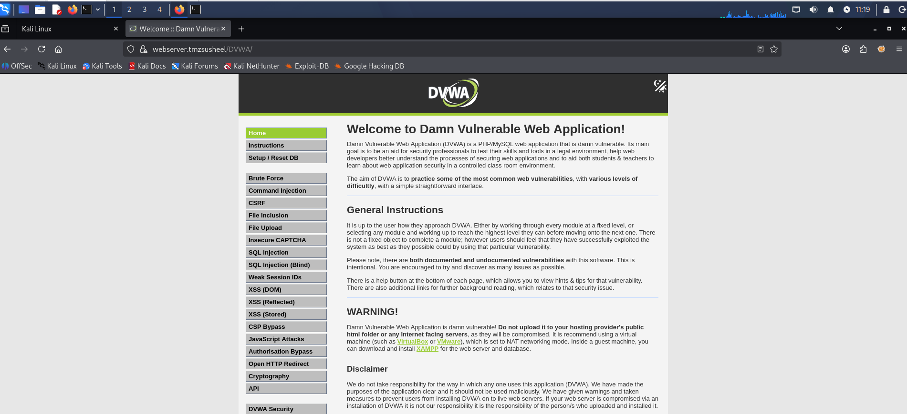

*Figure 10. Original browser screenshot of the DVWA application.*

### 07 · Configure SafeLine's HTTPS reverse proxy

Under **SafeLine WAF → Applications → Detail**, the protected application is set to **Defense Mode**, port **443/HTTPS**, **Reverse Proxy** access method, with upstream **\`http://192.168.177.138:9443\`**.

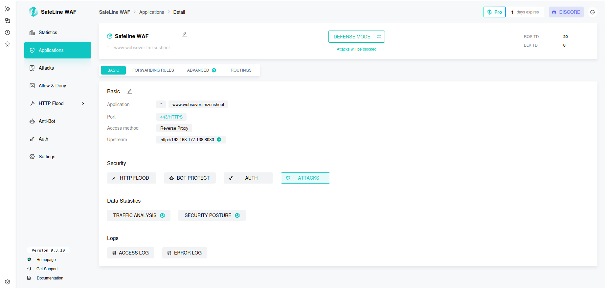

*Figure 11. Application configuration showing the actual port, reverse proxy routing, and upstream.*

### 08 · Review custom blacklist and deny rules

I reviewed **Allow & Deny → Custom Rules**. The **Malicious IP Intelligence Group Block** rule is shown as **Enabled**. The **Malicious JA4 Fingerprint**, **Malicious IP**, and **Block Kali** rules are visible but **Disabled** at the screenshot time. The Kali-specific rule references **192.168.177.129**, but its disabled state means the screenshot does not demonstrate it actively blocking that address.

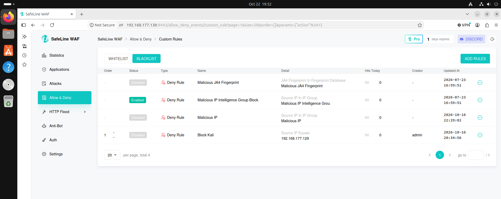

*Figure 12. Actual custom-rule list and enabled/disabled states.*

### 09 · Validate HTTP flood rate limiting

Under **HTTP Flood → Rate Limiting**, the event list reports a threshold of **3 requests within 20 seconds** and a **1-minute blocking action**. The screenshot includes rate-limiting events associated with the lab IPs **192.168.177.129** and **192.168.177.138**.

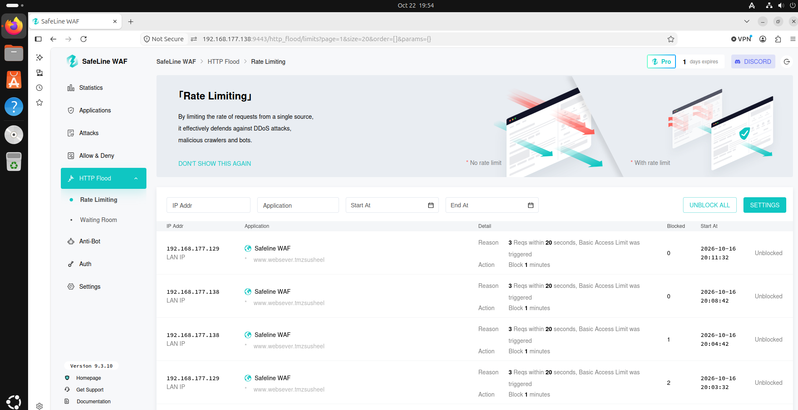

*Figure 13. Rate-limiting event records and recorded access-limiting actions.*

### 10 · Review semantic analysis controls

Under **Attacks → Semantic Analysis**, multiple categories—including **SQL injection**, **XSS**, **file uploads**, **file inclusion**, and **command injection**—are shown in **Balance Mode**. This documents the configured detection posture; the actual Blocked/Audited outcomes are confirmed separately in the attack logs.

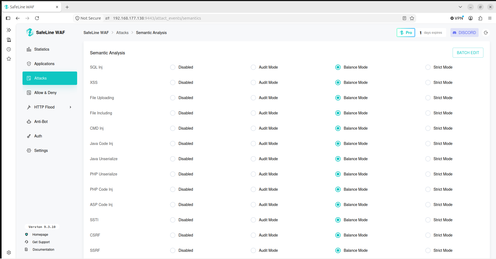

*Figure 14. Semantic analysis settings showing Balance Mode for web attack categories.*

### 11 · Review authentication records

Under **Auth**, the WAF logged both **successful** and **failed** password-based authentication outcomes with source IPs and timestamps. I used this page to examine authentication-event visibility and distinguish successful access from rejected credentials.

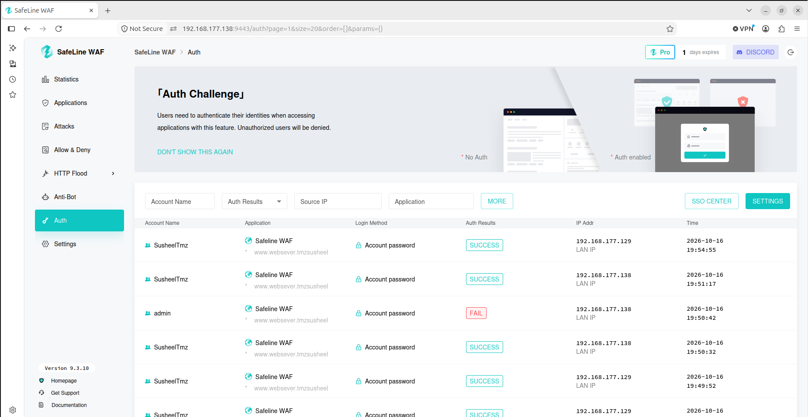

*Figure 15. Authentication outcomes and associated source IPs in the lab.*

### 12 · Review WAF-detected web attacks

I examined **Attacks → Logs** after authorized security testing of DVWA. The captured table shows:

- **XSS** requests to \`/DVWA/vulnerabilities/xss_r/\` marked **Blocked**.
- **Command injection** events to \`/DVWA/vulnerabilities/exec/\` marked **Audited**.
- Recorded source IP **192.168.177.129**, attack classification, target URL and timestamp.

Importantly, an **Audited** event means the WAF recorded it; it does **not** mean the WAF blocked it.

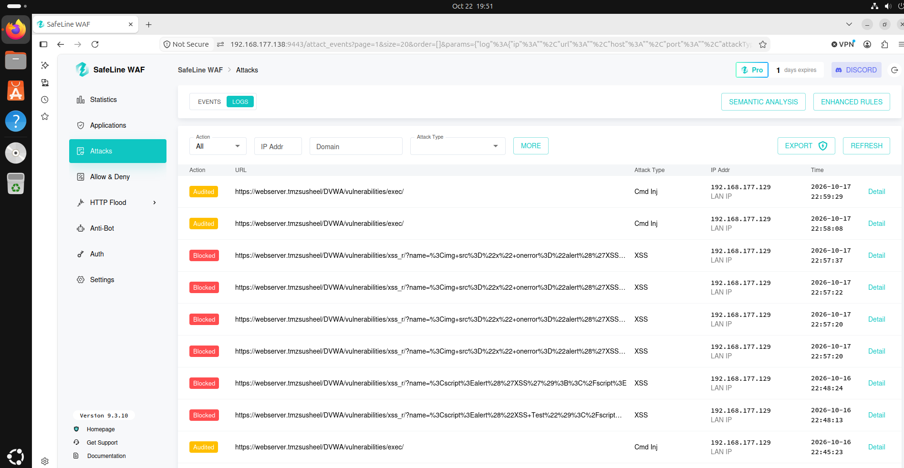

*Figure 16. Original attack-log evidence from **16–17 October 2026**, showing distinct blocking and auditing decisions.*

### 13 · Correlate events and monitoring dashboards

I compared the **Attacks → Events** summary with the traffic statistics and security-protection dashboard. The event view groups activity by source IP and time; the dashboard provides visibility into request volume, blocked requests, visitors, and recent web attack activity.

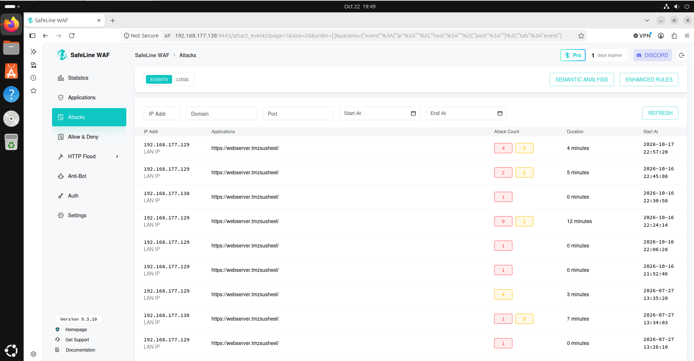

*Figure 17. Recorded event groups, durations and attack counts.*

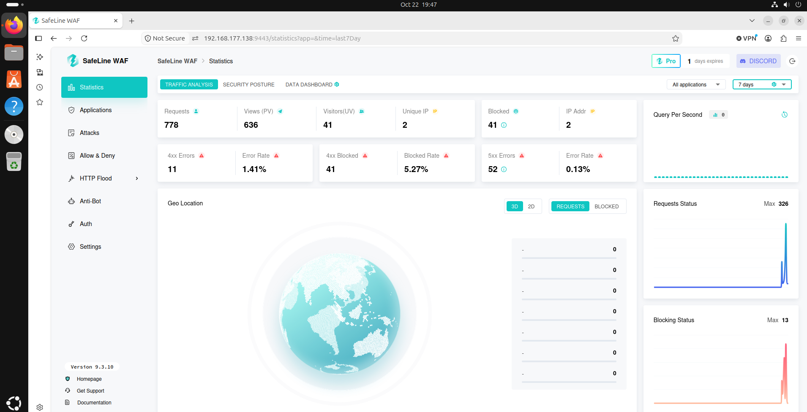

*Figure 18. Actual seven-day statistics snapshot.*

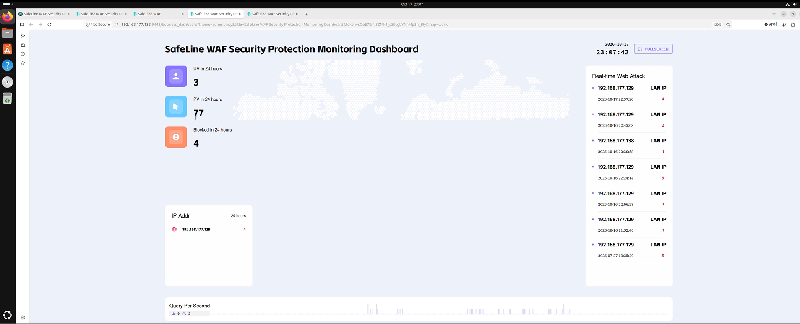

*Figure 19. Separate 24-hour monitoring snapshot; it should not be combined with the seven-day counters as one measurement period.*

## 📈 Observed results

| Evidence area | Recorded observation | Interpretation |
|:--|:--|:--|
| WAF reverse proxy | HTTPS **443** → HTTP **192.168.177.138:8080** | Front-end protection and backend routing configured |
| Attack logs | Multiple **XSS events blocked** | SafeLine blocked the recorded XSS test requests |
| Command injection | Events marked **Audited** | Requests were recorded but not shown blocked |
| Rate limiting | **3 requests/20 seconds**, **1-minute** action | Rate-limit triggers and restrictions recorded |
| Security statistics | **778 requests**, **41 blocked** | **5.27% blocked** in the displayed seven-day window |
| Auth logs | Successful and failed authentication events | Source/timestamp attribution supported |
| Monitoring dashboard | **4 blocked in 24 hours** | A different, shorter observation window |

### SOC Level 1 analyst takeaways

The lab strengthened my ability to **validate web attack alerts, distinguish blocked from audited activity, examine WAF policy states, correlate source addresses and event timestamps, and document defensive-control results**. I also learned to separate a designed enterprise topology from the specific services actually shown running, and to recognize how attack visibility differs from verified prevention.

## 📚 Detailed documentation and evidence

- **[Evidence catalog and screenshot captions](docs/EVIDENCE.md)**
- **[Environment and configuration walkthrough](docs/DEPLOYMENT.md)**
- **[Detection analysis and security findings](docs/DETECTION_FINDINGS.md)**
- **[Original image file index](assets/evidence/README.md)**

### Project scope and safety

DVWA is intentionally vulnerable and was used only for authorized security testing. The included paths and RFC 1918 addresses refer to a private lab. The enterprise architecture diagram depicts a simulated financial organization, not an actual employer infrastructure. Configuration screenshots do not contain a copy of the underlying credential or private-key material.

### 🙏 Special thanks

Special thanks to **The Social Dork** for the helpful YouTube explanations and step-by-step guidance on SafeLine WAF that supported my learning and implementation of this security lab. [Guidance reference](https://share.google/oPm68wbxM8S4fXGLJ).

---

**Web Security Monitoring · Evidence-Based Triage · Detection Validation**

[← Back to GitHub Portfolio](https://github.com/Ryalghost-SusheelTmz)

